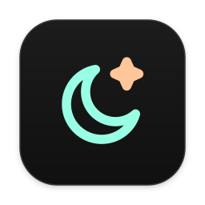
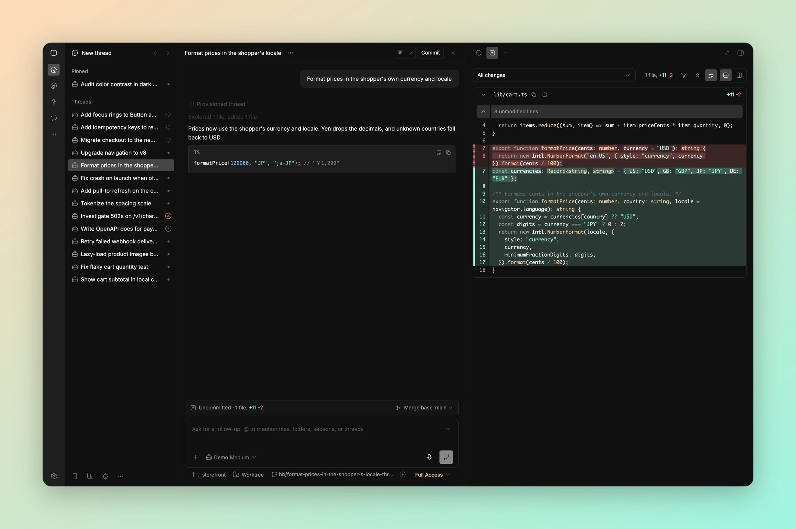
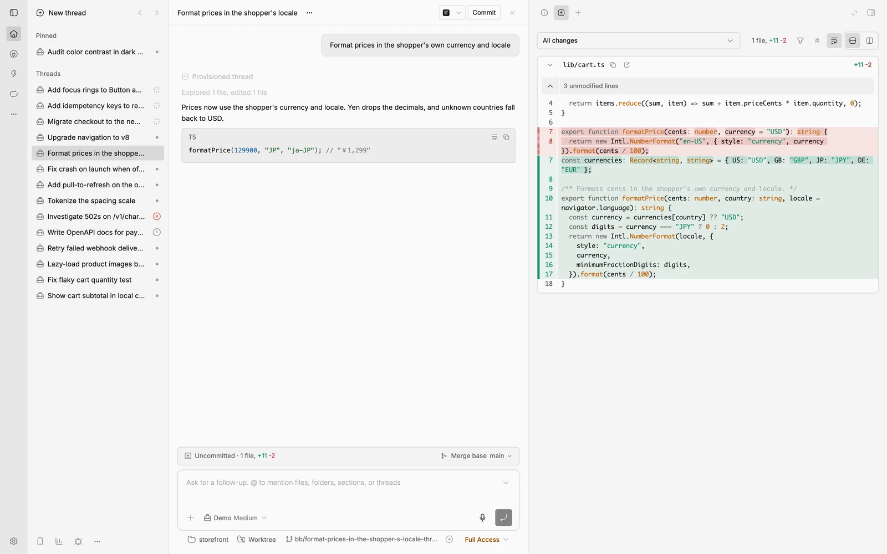
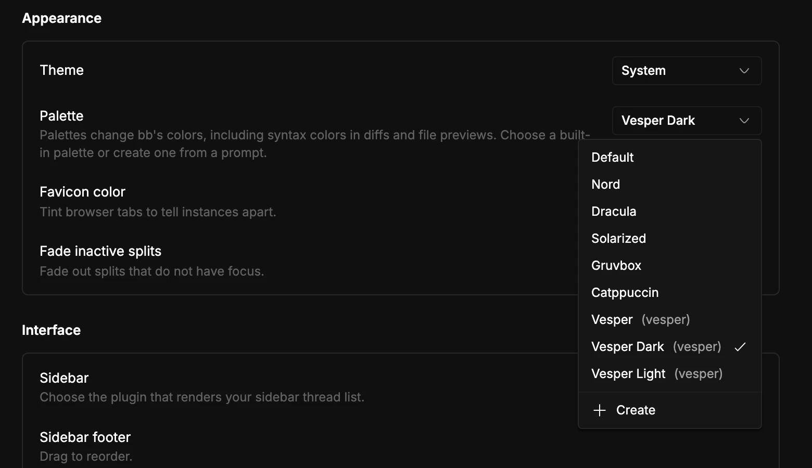

<p align="center">
  
</p>

<h1 align="center">Vesper</h1>

<p align="center">
  <strong>Peppermint and orange for BB.</strong>
</p>

<p align="center">
  <a href="#highlights">Highlights</a> ·
  <a href="#screenshots">Screenshots</a> ·
  <a href="#installation">Installation</a> ·
  <a href="#development">Development</a>
</p>

<p align="center">
  
</p>

Vesper brings Rauno Freiberg's [Vesper](https://github.com/raunofreiberg/vesper) color theme to BB. It recolors the app, the code in diffs and file views, and the terminal, in dark and light.

## Highlights

- 🌗 **Three palettes.** Vesper follows BB's light or dark mode. Vesper Dark is always dark, and Vesper Light is always light.
- 🍊 **Code in the same colors.** Diffs and file views use Vesper's syntax colors. The dark code theme is Vesper's own, and the light one maps the same hues onto white.
- 🖥️ **The terminal matches.** All 16 terminal colors come from the same palette.
- 🪶 **Only colors.** The plugin is CSS and JSON. It runs nothing in the background and needs no account.

## Screenshots

<p align="center">
  
  
</p>

## Installation

```sh
bb plugin install https://github.com/dillionverma/bb-plugin-vesper
```

Choose **Vesper**, **Vesper Dark** or **Vesper Light** in **Settings → Appearance → Palette**, or set one from a terminal:

```sh
bb theme set plugin:vesper:vesper
```

Requires BB 0.46 or later.

## Development

```sh
git clone https://github.com/dillionverma/bb-plugin-vesper.git
cd bb-plugin-vesper
npm ci
bb plugin install .
```

Run `npm test`, `npm run typecheck` and `bb plugin build` before submitting changes.

## License

[MIT](LICENSE). Vesper's palette and its dark code theme are by Rauno Freiberg, under the MIT license in [licenses/VESPER.txt](licenses/VESPER.txt).
